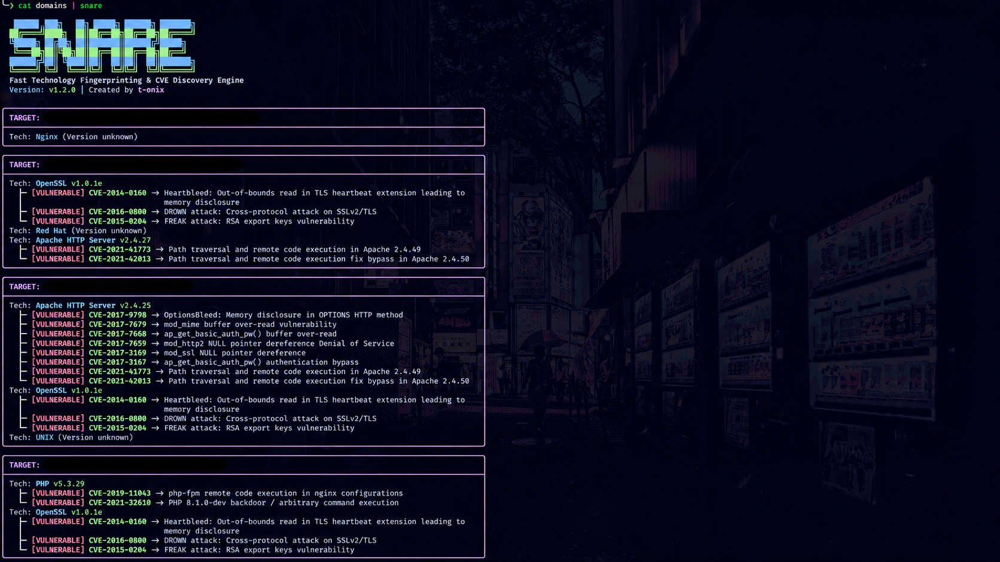

# 🕸️ SNARE

<p align="center">
  
</p>

<p align="center">
  <strong>Automated Web Technology Fingerprinting & CVE Discovery Engine</strong>
</p>

<p align="center">
  <a href="https://golang.org"></a>
  <a href="https://github.com/t-onix/snare/blob/main/LICENSE"></a>
</p>

---

**SNARE** is a high-performance reconnaissance tool built in Go, designed specifically for security researchers and bug bounty hunters. It automatically probes target domains to identify running technologies, web servers, and framework versions, then cross-references them against indexed CVE vulnerability databases to highlight potential attack surfaces.

### Visual Preview

```text
╭──────────────────────────────────────────────────────────────────────────────────────────────────────────╮
│ TARGET:  https://example-vulnerable-host.com                                                             │
├──────────────────────────────────────────────────────────────────────────────────────────────────────────┤
│ Tech: OpenSSL v1.0.1e                                                                                    │
│   └─ [VULNERABLE] CVE-2014-0160 -> Heartbleed: Out-of-bounds read in TLS heartbeat extension leading to  │
│                                    memory disclosure                                                     │
│ Tech: Apache HTTP Server v2.4.25                                                                         │
│   ├─ [VULNERABLE] CVE-2017-9798 -> OptionsBleed: Memory disclosure in OPTIONS HTTP method                │
│   └─ [VULNERABLE] CVE-2021-41773 -> Path traversal and remote code execution in Apache 2.4.49            │
╰──────────────────────────────────────────────────────────────────────────────────────────────────────────╯
```

### Features

- Smart Probe & HTTP Transport
    Accepts bare domain names, standard HTTP/HTTPS URLs, or IP addresses
    Performs automatic protocol fallback (tries HTTPS first with SSL verification disabled, falling back to HTTP if needed)
    Operates asynchronously using a concurrent worker pool for maximum speed

- Technology Fingerprinting Engine
    Leverages projectdiscovery/wappalyzergo for high-speed pattern matching.
    Analyzes HTTP response headers, cookies, HTML bodies, and meta tags.
    Extracts exact version numbers when exposed

### Installation

- Go Install (Recommended)

```bash
go install github.com/t-onix/snare@latest
```

- Build from Source

```bash
git clone https://github.com/t-onix/snare.git
cd snare
go mod tidy
go install .
```

### Usage

```
SNARE - Web Technology Fingerprinting & CVE Discovery Engine

Usage:
  snare [flags]

Flags:
  -c int
    	Number of concurrent workers (default 10)
  -d string
    	Single target domain or URL
  -f string
    	File containing list of targets
  -no-banner
    	Disable startup ASCII banner
  -o string
    	File to save raw results (without UI elements)
```

### Examples

- Single Target Scan

```bash
snare -d example.com
Or
echo target.com | snare
```

- Multi-threaded Scan from File & Save Output

```bash
snare -f hosts.txt -c 25 -o results.txt
```

- Pipeline Integration

```bash
subfinder -d target.com -silent | httprobe | ./snare -c 30 -o live_cves.txt
```

### Contributing

Contributions are welcome! If you find a bug or have a feature request, please open an issue or submit a pull request
